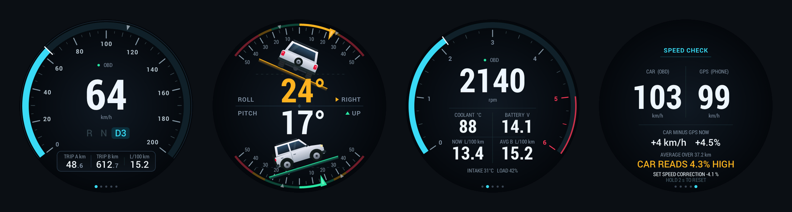

# TrailDash — off-road dash display for the Waveshare ESP32-S3-Touch-LCD-2.8C

**A round 480×480 dash display for trucks and 4x4s: inclinometer with tilting vehicle silhouettes,
cluster-style speedometer with gear indicator, engine gauges and fuel use — on a Waveshare ESP32-S3 round LCD board,
with a wireless tilt sensor and a companion iPhone app.** Built for a 2005 Toyota 4Runner (with an
insert for its speedometer pod), but the inclinometer and GPS speed work in any vehicle, and the
OBD screens with most OBD-II cars through an ELM327 adapter.



## Features

- **Inclinometer** — roll and pitch with tilting vehicle silhouettes, amber/red warning zones,
  buzzer alarm and peak-angle memory. A gyro + accelerometer filter keeps it steady over bumps
  and quick when the truck really tilts.
- **Wireless tilt sensor** — a XIAO ESP32-C6 + MPU-6050 bolted somewhere solid streams raw IMU
  data over BLE, so the display can sit anywhere, at any angle.
- **Speedometer** — car speed from an ELM327 BLE OBD adapter, or GPS speed from the iPhone app;
  rev needle, two trip meters, max speed.
- **Gear indicator** — R / N / 1–5 and hold positions D4 / D3 / D2 / DL, decoded from Toyota's
  undocumented mode-21 data blocks (documented below).
- **Engine screen** — rpm, coolant, battery voltage, instant and average fuel use from the MAF sensor.
- **Speed check** — compares the car's speed to GPS and tells you the speedometer / tyre-size
  correction to enter.
- **Drive logs and settings on microSD**; settings also editable live from the iPhone app.
- **Smooth UI** — custom antialiased vector renderer, DMA-composited 30 fps screen slides; a PC
  preview tool renders every screen without hardware.
- **3D-printable enclosure** and a snap-in insert for the 4Runner's speedometer opening (CadQuery,
  STEP + STL included).

## Hardware

| Part | Notes |
|---|---|
| [Waveshare ESP32-S3-Touch-LCD-2.8C](https://www.waveshare.com/esp32-s3-touch-lcd-2.8c.htm) | the display: round 2.8" 480×480 IPS, touch, PSRAM, microSD slot |
| Seeed Studio XIAO ESP32-C6 + MPU-6050 or MPU-6500 (GY-521 board) | remote tilt sensor, 4 wires |
| ELM327 **BLE** OBD-II adapter (e.g. Vgate iOS-Vlink) | optional: car speed, rpm, gear, engine data |
| iPhone | optional: GPS speed, live settings (`ios/`, SwiftUI) |
| microSD card (FAT32) | optional: settings, trips, drive logs |
| 3D printer, PETG or ASA | optional: `enclosure/` |

## Quick start

1. Install [PlatformIO](https://platformio.org/) and flash the display:
   `pio run -t upload`
2. Wire the MPU-6050 to the XIAO (see [Remote IMU](#remote-imu-remote--the-tilt-sensor)) and flash it:
   `cd remote && pio run -t upload`
3. Mount the sensor rigidly, park on flat ground and **hold the screen for 2 s** to set level.
4. Optional: build the iPhone app (`ios/`), pair an OBD adapter, insert a microSD card.

To see the UI without any hardware: `tools/preview/build.sh` renders every screen to `preview/*.png`.

## Use

| Action | Effect |
|---|---|
| Tap | Next screen: speed → engine → inclinometer → peaks → speed check. The screen shown is remembered across power-ups (SD card). |
| Swipe left / right | Next / previous screen (it slides in) |
| Hold 2 s | **Set level** — park on flat ground first. The screen blinks off briefly while it is saved. |
| Hold 2 s on the speed screen | Reset max speed and trip (A) |
| Hold 2 s on the engine screen | Reset trip B and average fuel use |
| Hold 2 s on the speed check screen | Restart the car-vs-GPS average |
| Double-tap | Reset peak angles |
| BOOT button | Short = next screen, long = same as hold |

Mount the display wherever you like; the angles come from the remote IMU (below). Mount that
rigidly, then **set level once** on flat ground with it connected.

## GPS speed — iPhone app (`ios/`)

Open `ios/TrailDashLink.xcodeproj` in Xcode and set your team + bundle ID: copy them into `ios/Local.xcconfig` (gitignored, see `ios/Config.xcconfig`) or pick them under *Signing & Capabilities*.
Then run it on the iPhone and allow Location and Bluetooth.

- The app finds TrailDash (advertising as `TrailDash`), remembers it, and from then on
  iOS reconnects automatically whenever the car powers up — also with the phone locked.
- It sends speed + course about once per second; the device shows `--` after 3 s without data.
- Max speed and the two trips (A and B) are computed on the device and kept on the SD card (without
  a card they reset at power-up). They count only the car's own (OBD) speed, with the speed
  correction: distance is speed × time, so nothing is counted without the OBD adapter — GPS speed
  is still shown then, but not added to the trips. Trip A resets with max speed (hold on the speed
  screen), trip B with the average fuel use (hold on the engine screen), so B can run long-term.
- With an OBD-II BLE adapter (ELM327, e.g. Vgate iOS-Vlink) in the car, speed comes from the car
  instead (status shows **OBD**); see `src/obd.cpp`.
- The **speed screen** looks like a car cluster: a rev needle (OBD rpm; it rests on 0 without OBD,
  red zone from `redline`), the current gear next to a lamp (green = speed source live, amber =
  OBD adapter not delivering yet, grey = no speed), the speed, trip A / max below it, then trip B
  and the source (a long warning like OBD CONNECTING takes that whole line).
  The box shows **N** in P or N (the car doesn't tell them apart), **R** in reverse and the current
  gear (1–5) in D. A gear hold position lights orange as **D4**, **D3**, **D2** or **DL**. It comes from the engine ECU's Toyota data blocks, found by probing a 2005 4Runner:
  `21DA` byte A = gear, `21E6` byte A bit 0x10 = P/N (0x04 = brake pedal), `21D9` bytes C, D = lever
  (R `04 00`, D `00 04`, 4 `00 06`, 3 `00 01`, 2 `02 00`, L `03 00`).
  On other cars it shows `-`.
- The **engine screen** (OBD only) shows a rev gauge (red zone: `redline` in config.txt), coolant
  (blue = cold, amber from 105 °C, red from 110 °C), adapter voltage, fuel use now (L/100 km, or L/h
  when standing) and the average since trip B was reset, plus intake temperature and engine load.
  Fuel use is calculated from the mass airflow sensor (air ÷ 14.7): right at cruise, low under full
  throttle. The adapter reads ~0.3 V below the battery, so 12.8–13.0 V at idle is normal.
- The **speed check** screen shows the car's (OBD) and the phone's GPS speed side by side, the
  difference now, and the average difference over the distance driven with both above 20 km/h
  (GPS lags about a second, which averages out). That is the speedometer / tyre-size error.
  It also shows the **speed correction** that would cancel it ("SET SPEED CORRECTION +8.7 %"):
  enter that in the app (*Device Settings → Car Speed*, or `speed_correction` in config.txt). The
  car's speed is then multiplied by 1 + correction / 100 everywhere: speed screen, trip, max, fuel
  use, and the car side of the speed check (its label shows the correction in use).
- GPS runs only while TrailDash is connected. Set Location to **Always** so GPS can start
  when the device connects while the phone is locked.
- iOS doesn't reopen a swiped-away app for Bluetooth. The in-app option *Restart after swipe-away*
  covers that with low-power location monitoring (the location arrow then stays on).
- With a free Apple ID the app must be re-installed from Xcode every 7 days.

### Device settings in the app

*TrailDash Link → Device Settings* (while TrailDash is connected) changes the `config.txt`
settings live: warning/danger angles, alarm sound, brightness (the screen follows the slider), rev
gauge red zone, car speed correction, drive log on/off + interval, remote IMU forward axis, OBD adapter
name and probe.
Changes apply at once and are written to `config.txt` a second after the last one (without an SD
card they last until power-off). It also has **Set level**, **Reset peaks**, **Reset trip** (A + max speed) and **Reset trip B** (+ average fuel).
Only the OBD probe needs a restart; a new forward axis needs *Set level* again.
Debug builds started with the launch argument `-demoDevice` show the screen with a pretend device.

Protocol (service/characteristic UUIDs, 10-byte packet, settings text, action bytes) is documented in `src/ble.h`.

## Remote IMU (`remote/`) — the tilt sensor

Pitch and roll come from a separate sensor — Seeed **XIAO ESP32-C6** + **MPU-6050/6500** (GY-521
style board) — mounted somewhere solid in the car (e.g. bolted to the floor/tunnel), streaming to the
display over Bluetooth LE. The display's own IMU is not used, so the display can sit anywhere.

Wiring: XIAO `3V3`→VCC, `GND`→GND, `D4` (GPIO22)→SDA, `D5` (GPIO23)→SCL.

```sh
cd remote && pio run -t upload
```

- Mount it with the board's **X arrow pointing forward** (or set `remote_forward` in `config.txt`,
  e.g. `-y`), any tilt is fine. Power it up with the car standing still: it measures its gyro bias in the
  first 2 s (and remembers it for power-ups while driving).
- It finds TrailDash on its own (LED: fast blink = searching, short flash every 3 s = connected).
- Without data for 0.5 s the gauge shows **NO SENSOR** (no angles, no alarm, peaks paused); when the
  sensor is back the filter re-seeds from it in ~0.1 s.
- Raw samples (250 Hz, sent 10 per packet) go through the tilt filter on the display.
  Protocol: `shared/imu_link.h`. Serial `i` on the display prints link statistics.

## Settings and SD card

`src/config.h` holds the defaults (and filter tuning). With a microSD card (FAT32) in the display,
the user settings are in `/incl/config.txt` — written with the defaults on first start; edit it on a
computer and restart. The card also stores:

| File | Content |
|---|---|
| `/incl/config.txt` | warning/danger angles, buzzer, backlight, drive log on/off + interval, OBD adapter name, remote IMU forward axis, rev gauge red zone, car speed correction, OBD probe on/off |
| `/incl/rlevel_a.txt`, `rlevel_b.txt` | level reference (of the remote IMU) |
| `/incl/state_a.txt`, `state_b.txt` | peak angles, max speed, trips A and B, fuel used for the average, drive log counter |
| `/incl/logs/NNNNN.csv` | drive log, one file per power-up: angles, speed + source, heading, OBD values, trips A and B |
| `/incl/probe.txt` | OBD probe (`obd_probe = 1`, Toyota only): the gear / selector data blocks (21DA, 21E6, 21D9), each reply logged when it changes (also printed to serial), with speed / rpm / throttle / gear / selector |

Records are written alternately to the `_a`/`_b` file with a sequence number and checksum, so a power
cut during a write keeps the previous version. The drive log reaches the card every 10 s.
Without a card the level reference falls back to internal flash (screen blinks while saving) and
nothing else is kept. A level reference already in flash is copied to a new card automatically.

Without a card reader, over USB serial: `s` lists the files, `o` prints the end of `obd.txt`,
`b` the end of `probe.txt` (`b500` = its last 500 KB),
`c21` prints drive log 21, `v` prints the current screen, trips, fuel and comparison totals.
`t` resets trip A + max, `T` trip B + average fuel.

## How it works

- `tilt.cpp` — complementary tilt filter. The gyro turns the reading instantly when the car really
  tilts; the heavily smoothed accelerometer keeps it true, so gyro errors fade instead of building up
  (no trust gating, no integral term, no bias learning while driving). Median filter against spikes
  and bump rejection. Accelerating/braking briefly shows as pitch — by design. `TILT_GYRO_CARRY 0`
  in `config.h` switches to accelerometer-only angles. Readout is whole degrees with hysteresis.
- `ble.cpp` — NimBLE peripheral; the phone writes GPS packets to it. Initialised before the display
  (the BT stack touches NVS flash), no bonding, so nothing is written to flash afterwards.
- `gfx.cpp` — small antialiased vector renderer (polygons, arcs, gradients, dithering, smooth fonts).
- `board.cpp` — ST7701 RGB panel with two PSRAM frame buffers. Frames are drawn in 16-row strips in
  internal SRAM and moved to/from PSRAM by GDMA (the CPU path to PSRAM is too slow); strips whose
  content didn't change are skipped. A screen change slides: the old frame and the new screen are
  frozen in PSRAM and each slide frame is put together by DMA alone (~27 ms, PSRAM-bandwidth bound);
  the panel runs at 60 Hz meanwhile, so every 2nd refresh = 30 fps (at its normal 50 Hz: 25).
- Flash is never accessed while the display runs (the panel interrupt reads PSRAM, which is
  unavailable during flash operations) — without an SD card the panel is stopped for a moment when the
  level reference is saved. The SD card (`storage.cpp`, 1-bit SDMMC on the panel's init-SPI pins, which
  are released after display init) has no such restriction; it is written from a low-priority task.

## UI preview on a PC

```sh
tools/preview/build.sh     # renders all screens to preview/*.png
```

Fonts: Roboto / Roboto Condensed (Apache 2.0), regenerated with `swift tools/gen_fonts.swift > src/fonts_data.h`.

## Contributing

Issues and pull requests are welcome — especially OBD data from other vehicles (the
`obd_probe` setting logs the Toyota data blocks to the SD card) and photos of installs.
Licensed under the [MIT License](LICENSE).

## Development — use git

The project is under git (branch `main`). Work like this:

- Check `git status` / `git log --oneline` before starting, so you know the current state.
- Commit a working state before any risky change (filter rewrites, display/flash code), and
  commit each finished change separately with a message that says *why*.
- Don't make ad-hoc backup copies of files — revert with git instead
  (`git diff`, `git restore <file>`, `git revert <commit>`).
- Generated files are ignored (`.pio`, preview `.bmp`/binary, Xcode `xcuserdata`); the preview
  PNGs, enclosure STEP/STL and renders are committed — regenerate and commit them with the change
  that affects them.

